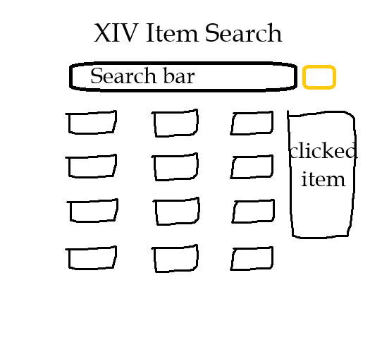
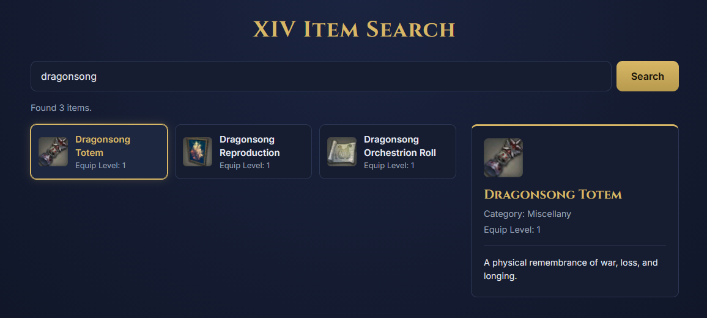

# AJAX/API Projekti

**Tekijä:** Rasmus Bergholm

## Projektisuunnitelma

### Projektin idea

Halusin kokeilla luoda jonkinlaisen sivun, joka käyttää XIV API V2:a. Päädyin lopulta luomaan item search -tyyppisen sivun, koska siinä oli paljon opittavaa.

### Suunnitellut toiminnot

- Hakee termillä API:n kautta XIV-itemejä.
- Näyttää errorit, jos niitä tulee. Sama funktioiden statuksille.
- Näyttää oikealla puolella valitun asian + enemmän infoa.

### Rautalankamalli 

## Verkkolinkit

- **Julkaistu sovellus:** [Linkki](https://rasmusdb.github.io/web-developer-2-project2/)
- **GitHub-repositorio:** [Linkki](https://github.com/RasmusDB/web-developer-2-project2)
- **Projektin videoesittely:** [Linkki](https://youtu.be/3LazP_SZvNo)

## Tietoja sovelluksesta

**XIV Item Search** on verkkosovellus, jolla voi hakea XIV-databasesta kaikkia itemejä, ja näyttää infoa klikatusta asiasta.

## Teknologiat

- HTML – sivun rakenne
- CSS – ulkoasu ja asettelu
- JavaScript – toiminnallisuus, DOM-skriptaus ja lomakkeiden validointi, AJAX
- GitHub (Pages), Main.yml ja app.js sivun hostaamiseen ja API-avaimen piilottamiseen.

## Sovelluksen käyttö

Kirjoita lyhyet käyttöohjeet sovellukselle.

1. Avaa julkaistu sovellus yllä olevasta linkistä.
2. Täytä hakukenttä
3. Klikkaa "Search" tai paina Enter.
4. Klikkaa jotain hakutulosta.

## Kuvakaappaukset

## Tunnetut virheet / puutteet
**Ei tunnettuja virheitä.**

## Oma arvio ja oppimisen reflektointi

Pohdi työtäsi ja oppimisprosessiasi.

- Missä onnistuin? Oman suunnitelman luomisessa ja tarvittavien tietojen oppimiseen.
- Mikä oli haastavaa? Js-koodin kirjoittaminen.
- Mitä parantaisin, jos aikaa olisi enemmän? Laajentamalla projektia lisäämällä funktioita, esim. filtereitä.
- Mitä opin HTML:stä, CSS:stä, JavaScriptistä ja DOM-skriptauksesta? AJAXin käyttöä paljon!
- Mikä jäi epäselväksi tai mistä haluaisin oppia lisää? En ole varma.
- Oma arvio projektista: **8/10 pistettä**

## Lähteet ja kiitokset

- Canvas-materiaalit
- Käytetty tekoälytyökalu: Claude
  - Miten työkalua käytettiin: ns. building blockien antamiseen ja koodin muokkaamiseen jälkikäteen. Videossa selitetty tarkemmin.

  ## Lisenssi

Tämä projekti on lisensoitu MIT-lisenssillä.

Lisätietoa lisenssin lisäämisestä GitHub-projektiin:
https://docs.github.com/en/communities/setting-up-your-project-for-healthy-contributions/adding-a-license-to-a-repository
